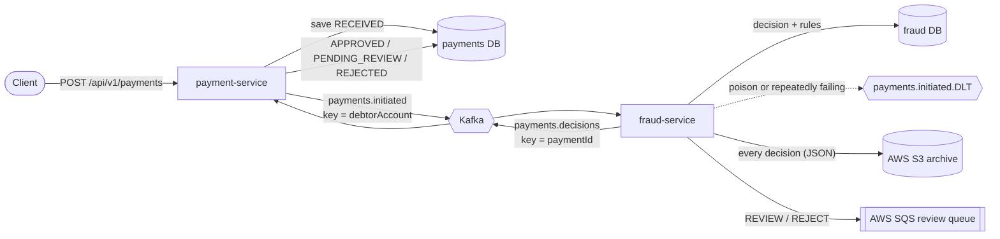

# PayGuard — event-driven payments with real-time fraud screening

Two Spring Boot microservices that talk over **Apache Kafka**. The payment API accepts a payment,
the fraud service scores it with a pluggable rule engine, and the verdict flows back to update the
payment — all asynchronously.

**Stack:** Java 21 · Spring Boot 3.3 · Spring Kafka · PostgreSQL 16 · Flyway · AWS (S3, SQS via AWS SDK v2) · Docker Compose / LocalStack · JUnit 5 / Mockito · GitHub Actions

## Architecture



| Topic | Key | Producer | Consumer |
|---|---|---|---|
| `payments.initiated` | debtor account | payment-service | fraud-service |
| `payments.decisions` | payment id | fraud-service | payment-service |
| `payments.initiated.DLT` | original key | fraud-service (error handler) | — |

## Fraud rules

Each rule is an independent `FraudRule` bean; `RiskScorer` runs all of them, sums the points (cap 100)
and maps the total to a decision (`>= 40` REVIEW, `>= 70` REJECT; both configurable).

| Rule | Fires when | Points |
|---|---|---|
| `HIGH_VALUE` / `HIGH_VALUE_EXTREME` | amount ≥ 10,000 / ≥ 50,000 | 40 / 70 |
| `HIGH_RISK_COUNTRY` | beneficiary country in configured list (default KP, IR, SY) | 60 |
| `UNATTENDED_CHANNEL_LARGE` | `API` channel and amount ≥ 5,000 | 20 |
| `VELOCITY` | more than 5 payments from one account within 1 minute | 40 |

Adding a rule = one class implementing `FraudRule`.

## AWS integration

The fraud service can write to AWS (AWS SDK for Java v2), switched on with `aws.enabled=true`:

| Resource | Purpose |
|---|---|
| S3 bucket `payguard-decision-archive` | Audit trail: every decision stored as `decisions/<date>/<paymentId>.json` |
| SQS queue `payment-review-queue` | Work queue of REVIEW and REJECT payments for analysts, with a `decision` message attribute |

- Credentials use the SDK's default provider chain (environment, profile or IAM role) — nothing is hard-coded.
- `docker compose` runs **LocalStack** and creates the bucket and queue, so it works without an AWS account. The dummy `test` credentials in `docker-compose.yml` are for LocalStack only.
- To use real AWS, set `AWS_ENABLED=true`, leave `AWS_ENDPOINT` empty, create the bucket and queue, and give the service an IAM role allowed `s3:PutObject` and `sqs:SendMessage` / `sqs:GetQueueUrl`.
- Both calls tolerate Kafka's at-least-once delivery: the S3 key comes from the payment id (a retry overwrites the same object), and SQS standard queues may deliver duplicates, so review-queue consumers must be idempotent.
- With `aws.enabled=false` (the default) a no-op sink is used and only Kafka and PostgreSQL are required.

Check it after running the demo requests below:

```bash
docker exec payguard-localstack awslocal s3 ls s3://payguard-decision-archive --recursive
docker exec payguard-localstack awslocal sqs receive-message \
  --queue-url http://sqs.eu-west-2.localhost.localstack.cloud:4566/000000000000/payment-review-queue
```

## Run it

Requires Docker.

```bash
docker compose up --build
```

Then, in another terminal:

```bash
# 1. Small domestic payment -> APPROVED
curl -s -X POST localhost:8080/api/v1/payments -H 'Content-Type: application/json' -d '{
  "endToEndId":"E2E-001","debtorAccount":"GB11DEBTOR0001","creditorAccount":"GB22CREDIT0001",
  "amount":250.00,"currency":"GBP","channel":"ONLINE","creditorCountry":"GB"}'

# 2. Large payment -> PENDING_REVIEW (HIGH_VALUE, score 40)
curl -s -X POST localhost:8080/api/v1/payments -H 'Content-Type: application/json' -d '{
  "endToEndId":"E2E-002","debtorAccount":"GB11DEBTOR0002","creditorAccount":"GB22CREDIT0001",
  "amount":20000.00,"currency":"GBP","channel":"ONLINE","creditorCountry":"GB"}'

# 3. Extreme amount + high-risk country + API channel -> REJECTED (score 100)
curl -s -X POST localhost:8080/api/v1/payments -H 'Content-Type: application/json' -d '{
  "endToEndId":"E2E-003","debtorAccount":"GB11DEBTOR0003","creditorAccount":"IR33CREDIT0009",
  "amount":60000.00,"currency":"GBP","channel":"API","creditorCountry":"IR"}'

# Poll a payment (id comes from the POST response); status moves RECEIVED -> final within a second or so
curl -s localhost:8080/api/v1/payments/<id>

# Re-send request 1: same endToEndId -> 200 with the original payment, no second Kafka event
```

Inspect the topics:

```bash
docker exec -it payguard-kafka /opt/kafka/bin/kafka-console-consumer.sh \
  --bootstrap-server localhost:9092 --topic payments.decisions --from-beginning
```

Run only the infrastructure and start the services from your IDE: `docker compose up kafka postgres localstack`
(services default to `localhost:29092` and `localhost:5432`; for AWS locally set `AWS_ENABLED=true`,
`AWS_ENDPOINT=http://localhost:4566`, `AWS_ACCESS_KEY_ID=test`, `AWS_SECRET_ACCESS_KEY=test`).

## Tests

```bash
mvn verify
```

Unit tests cover each fraud rule (including the sliding velocity window with a controllable clock),
score-to-decision mapping, idempotent decision handling, the S3/SQS sink (mocked AWS clients), the payment service (idempotency, status
transitions) and the REST layer (`@WebMvcTest`: 201 / 200 / 400 / 404).
CI runs the same command on every push (`.github/workflows/ci.yml`).

## Design decisions

- **Idempotent API.** `endToEndId` is unique. A retried request returns the original payment (HTTP 200) and publishes nothing; a concurrent duplicate loses on the unique constraint and gets HTTP 409.
- **Ordering per account.** `payments.initiated` is keyed by debtor account, so one account's payments stay in order on one partition — which is what lets the velocity rule work with local state.
- **At-least-once, handled.** The fraud service stores each decision with `payment_id` as primary key; a redelivered message returns the stored decision instead of being re-scored. The payment service ignores a decision for a payment that is already decided.
- **Publish after commit.** The Kafka event is sent from a `@TransactionalEventListener(AFTER_COMMIT)`, so a rolled-back payment is never announced.
- **Failure handling.** The consumer retries with exponential backoff (4 retries, 0.5 s → 5 s), then dead-letters to `payments.initiated.DLT`. Messages that cannot be deserialised go straight to the DLT (`ErrorHandlingDeserializer`) instead of blocking the partition.
- **Producer safety.** `acks=all` and `enable.idempotence=true`.
- **Schema managed by Flyway**, one database per service.

## Known limitations / next steps

- **Outbox:** if the payment service crashes between DB commit and Kafka send, the event is lost. A transactional outbox table would close this gap.
- **Velocity state** is in memory and per instance; use Kafka Streams state stores or Redis for a durable, scalable version.
- **No FX conversion:** amount thresholds are applied in the payment's own currency.
- **Message format** uses ISO 20022-style field names (end-to-end id, debtor, creditor) but is not a real `pacs.008` message.
- **Integration tests** with Testcontainers (real Kafka + Postgres + LocalStack) are not included yet; the AWS code is unit-tested with mocked clients and has not been exercised against a real AWS account.
- The database is plain PostgreSQL in Docker; pointing `SPRING_DATASOURCE_URL` at Amazon RDS needs no code change but is not set up here.
- No authentication on the REST API; this is a demo of the event flow, not a hardened service.
